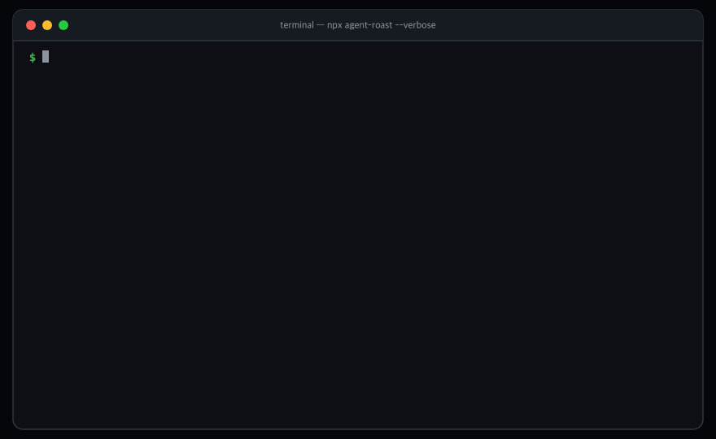
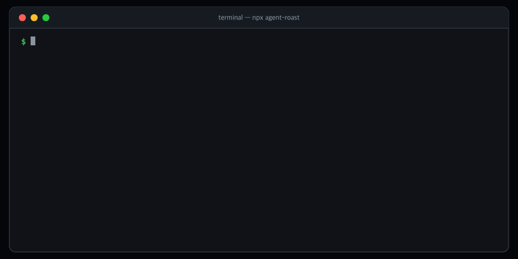

<div align="center">

<picture>
  <source media="(prefers-color-scheme: dark)" srcset="docs/assets/logo-dark.svg">
  
</picture>

<h2>Catch coding shortcuts before they ship</h2>

<p>
  <a href="https://github.com/Nari-Ab/agent-roast/actions/workflows/test.yml"></a>
  <a href="https://www.npmjs.com/package/agent-roast"></a>
  <a href="https://www.npmjs.com/package/agent-roast"></a>
  <a href="https://nari-ab.github.io/agent-roast/"></a>
  <a href="LICENSE"></a>
</p>

</div>

`agent-roast` is an offline review aid for skipped tests, fake assertions, swallowed
errors, unfinished stubs and type-check bypasses. Start with the code you have now;
no AI commit tags, cloud account, API key or commit history are required for `check`.
A Git repository is required; `git init` is sufficient.

```bash
# Inspect current tracked + non-ignored untracked source files
npx agent-roast check

# Understand a finding and what to do next
npx agent-roast explain swallowed-error

# Adopt it in an existing project without blocking on all historical debt
npx agent-roast check --write-baseline .agentroast-baseline.json
# Review the findings and commit this policy file, then gate only new problems
npx agent-roast check --baseline .agentroast-baseline.json

# Verify precisely what you are about to commit
npx agent-roast --staged

# Audit pull request diffs (CI gate)
npx agent-roast --base origin/main --head HEAD --format github

# Optional historical audit
npx agent-roast --all --verbose
```

A finding includes its file and line, the source snippet, and a concrete next step.
To see the complete machine-readable result, use `check --format json`; terminal
output shows the first 20 findings. `check --format markdown` produces a review table.

### Context review for pull requests (0.6.0, unreleased)

```bash
# Compare committed source at the common ancestor and candidate head
agent-roast review --base origin/main --head HEAD
agent-roast review --base origin/main --format markdown

# Export a report for tools that consume SARIF 2.1.0
agent-roast review --base origin/main --format sarif > agentroast.sarif
agent-roast check --format sarif > current-code.sarif
```

`review` compares **full contents of changed source files**, so deleting the only
handler inside a `catch` is detectable even when no suspicious line was added.
It reports new findings, existing findings, and patterns no longer detected. Only
new blocking findings fail the check; no manually generated baseline is required.
Deleting a file is reported as disappearance of a pattern, not proof of a correct fix.

Source is read directly from immutable Git blobs at the merge-base and head. The
worktree and index are left untouched, and project code, hooks, diff programs and
package scripts are never executed. Use `check` for uncommitted working files, and
`--staged` for the index. Source comparison and policy are pinned to the reported SHAs.

Policy comes from the explicitly supplied **base ref tip**; source comparison starts
at the merge-base. Candidate changes to `.agentroastrc.json`, `.agentroastrc` or
`agent-roast.config.json` are reported and ignored for this review. Adopt policy
changes through separate human review. An explicit `--fail-on` overrides blocking
severity but does not enable rules disabled by base policy.

```bash
# Advisory pilot: inspect findings before deciding what should block the team
agent-roast review --base origin/main --fail-on ''
# Gate the shortcuts the team agrees matter
agent-roast review --base origin/main --fail-on test-skip,trivial-assert,swallowed-error
```

Matching uses rule, source snippet and occurrence count within a file pair. Line
shifts and Git-recognized pure renames do not turn old debt into new debt. A second
identical occurrence is new. This is not semantic tracking: rewritten snippets or
language changes can require fresh review, and Git's rename recognition is heuristic.

Limits: 1,000 changed files, 2 MiB per source blob, 50 MiB across inspected versions,
30 seconds per Git command. Symlinked/binary/oversized source and missing comparison
objects yield exit 2, never a clean pass. Partial clones and ambiguous multiple
merge-bases are unsupported; fetch complete local history (`fetch-depth: 0`). The
report counts excluded and unsupported changes explicitly. Only changed supported
files are compared; this is not a whole-repository safety certification.

SARIF includes rule metadata, relative locations, stable occurrence fingerprints
and whether the scan completed. Source snippets are omitted from SARIF. JSON and
Markdown reports contain evidence snippets and should be handled as source code.
SARIF output is generated offline; uploading it is a separate, optional operation.
GitHub supports SARIF ingestion, but this release has not been tested with a live
code-scanning upload. Some findings on unchanged lines (including deletion-only
regressions) may appear in the report/summary rather than as an inline PR annotation.
Use a separate SARIF category for introduced-findings review; it does not represent
a full scan of all outstanding alerts.

For the new CLI in this checkout, run `npm run build` and use `node dist/cli.js`.
Published npm `latest` remains 0.5.0 until the release is explicitly published.

### Baseline adoption

A baseline explicitly accepts the findings present at adoption time. It does not fix
or hide new code. Fingerprints use the rule, repository-relative filename and source
snippet; line numbers are excluded so adding clean code above a finding does not
break it. Occurrence counts ensure a second identical shortcut is still new. Moving
a finding to another file or changing its snippet requires a fresh review. Baselines
contain hashes and counts, not source code. The report shows both accepted and new
findings and counts accepted findings no longer present.

Baseline use is explicit (`--baseline`), and writes refuse to overwrite existing
files. To refresh accepted debt, inspect the full scan and write a **new** baseline
file for review. Treat baseline changes as policy changes in code review. Do not
silently regenerate one in CI. Input/output baseline paths are relative to the
directory passed to `check` (or the current directory if omitted).

`check` scans the repository containing the supplied path, applies its root config,
respects Git ignores for untracked files, and excludes generated dependencies/build
outputs. It checks working files, while `--staged` checks the index. Git submodules
are not recursively scanned. A supported file that is binary, too large, unreadable
or a symlink makes the scan incomplete (exit 2); incomplete scans cannot create a
baseline. Limits are 2 MiB per source file and 50 MiB per scan. Intentional generated
or unsupported input should be excluded in `ignorePaths`, not silently counted clean.

History auditing remains available when you want an overview of prior shortcuts:

What a report looks like (a real repository audit, trimmed):

```text
agent-roast — git discipline audit (304 AI commits in Soup)

SCORE: 55 / 100 · The Panic Looper
  Prone to rapid-fire fix and revert thrashing cycles when wrestling stubborn bugs.

INFRACTIONS DETECTED (42)

  ● panic-loop (15) — consecutive quick fixes < 15m apart
      latest: 3df29a1 -> a910f21 (3m apart)

  ● type-escape (19) — compiler type bypasses in added lines
      e.g. src/client.ts:42 — response.body as any

  ● test-skip (6) — disabled or skipped test suites
      e.g. tests/test_outbound.py:18 — pytest.skip(...)

  ● trivial-assert (2) — tautological assertions faking test coverage
      e.g. tests/auth.test.ts:31 — expect(true).toBe(true)

  ● stub-abandonment (1) — incomplete stubs left behind
      e.g. src/payment.ts:18 — throw new Error("Not implemented")

  ● swallowed-error (2) — empty catch blocks or except: pass
```





---

### Configuration (`.agentroastrc.json`)

Configure custom ignore paths, rule severities, and CI thresholds with a `.agentroastrc.json` file in your repository root:

```json
{
  "$schema": "https://raw.githubusercontent.com/Nari-Ab/agent-roast/main/schema.json",
  "ignorePaths": [
    "**/*.min.js",
    "**/vendor/**",
    "**/dist/**",
    "**/fixtures/**"
  ],
  "rules": {
    "hallucinated-package": "error",
    "empty-catch": "warn",
    "trivial-assert": "warn",
    "stub-abandonment": "warn",
    "mock-leak": "warn"
  },
  "scoreThreshold": 70
}
```

---

### Check code before committing

```bash
npm install --save-dev agent-roast
npx agent-roast --staged
npx agent-roast init --hook
```

`--staged` audits exactly the Git index, including an initial commit without HEAD.
Unstaged edits and untracked files are excluded. The generated hook uses the locally
installed CLI (`--no-install`) and blocks on configured error rules instead of scoring
old commits. It preserves an existing pre-commit hook.

### Configure what blocks a change

Create `.agentroastrc.json` (or run `npx agent-roast init`):

```json
{
  "rules": {
    "test-skip": "error",
    "trivial-assert": "error",
    "swallowed-error": "warn",
    "type-escape": "off"
  },
  "ignorePaths": ["**/generated/**", "**/vendor/**"],
  "panicLoopWindowMinutes": 10,
  "scoreThreshold": 70
}
```

`off` removes findings and score penalties; `warn` reports without blocking a diff;
`error` blocks PR/staged checks. An explicit `failOn` array overrides which enabled
rules block (`[]` makes the audit advisory). CLI `--fail-on` takes precedence over
that array. History and badge audits honor disabled rules and the panic-loop window.
History exit status is controlled by `scoreThreshold` or `--fail-under`.
Invalid JSON, unknown rule names and invalid settings stop the audit with exit code 2.
Configurations generated by older versions may contain unsupported rules such as
`hallucinated-package`, `empty-catch` or `mock-leak`; remove these entries and use
`swallowed-error` for empty catches.

Exit codes: `0` passed, `1` blocking findings/score threshold, `2` invalid audit
configuration or Git refs. `--format json` also works for history audits. A history
sample below 200 added lines has no score, but its findings are still shown.

### GitHub Actions Integration

Add `agent-roast` as a gate in your pull request workflow (`.github/workflows/agent-roast.yml`):

```yaml
name: Agent Roast
on:
  pull_request:
    branches: [main]

permissions:
  contents: read

jobs:
  audit:
    runs-on: ubuntu-latest
    steps:
      - uses: actions/checkout@v4
        with:
          fetch-depth: 0 # Required for complete merge-base history

      - name: Run agent-roast audit
        uses: Nari-Ab/agent-roast@v1
        with:
          fail-on: test-skip,trivial-assert,stub-abandonment
          format: github
```

> **Security Note:** `agent-roast` runs in an isolated runner directory (`$RUNNER_TEMP`) with `--ignore-scripts` to neutralize malicious `.npmrc` files in untrusted pull requests. `pull_request_target` is not supported.

---

### What it checks

Only **added lines** (`+`) in source code files are scanned — deleted lines, file moves, and comments never trigger false alarms.

- **Skipped tests (`test-skip`):** `it.skip`, `describe.skip`, `xit`, `pytest.skip`, `test.todo` added to silence failing tests. (Default blocking gate).
- **Trivial assertions (`trivial-assert`):** Tautological or dummy assertions added to fabricate test green checks (`expect(true).toBe(true)`, `expect(1).toBe(1)`, `assert True`, `self.assertTrue(True)`).
- **Stub abandonment (`stub-abandonment`):** Dummy stubs left unimplemented in committed code (`throw new Error("Not implemented")`, `raise NotImplementedError`, Rust `todo!()` / `unimplemented!()`).
- **Type escapes (`type-escape`):** `as any`, `as unknown as`, `as never`, `// @ts-ignore`, `// @ts-nocheck`, `// @ts-expect-error`, `# type: ignore`, `# noqa`, `eslint-disable`.
- **Swallowed errors (`swallowed-error`):** Empty `catch {}` or `except: pass` blocks hiding runtime failures.
- **Panic fix loops (`panic-loop`):** Heuristic chain analysis of rapid-fire fix/revert commits by the same author within 15 minutes touching overlapping files. *(Observational metric for repository audits; not a PR blocker)*.

---

### Scoring Methodology

- **Repository Audit Score:** Uses size-invariant defect density:
  $$\text{Score} = 100 \cdot \exp\left(-\left(\frac{\text{codeDensity}}{R_0} + \frac{\text{panicDensity}}{R_1}\right)\right)$$
  where defect points are normalized by effective sample volume ($k\text{Loc} + 0.5$). Repositories with fewer than 200 lines added return `null` (insufficient data) rather than an arbitrary 100.
- **Pull Request Mode:** Avoids unstable micro-sample scores. Reports verified infractions, pass/fail status, and reference defect density per 100 LOC. Author identities are hidden by default to prevent team blame games.

---

### Requirements & Privacy

- **Requirements:** Git 2.30+ (for `--end-of-options` argument isolation), Node.js 18+.
- **100% Local:** Instant streaming parser runs directly on your machine.
- **Zero Telemetry:** No cloud dependencies, no LLM API calls, no network traffic. Verified by static bundle inspection.
- **Git isolation:** Forces stable diff paths, disables fsmonitor/external diff execution, and reads review content by object identity.

---

### Scope and limitations

Use this as a focused review aid for skipped tests, compiler suppressions and obvious
stubs, alongside a compiler, test runner and language-aware linter. Findings identify
patterns, not proof of AI authorship or developer intent. Deliberate skips and abstract
methods can be legitimate. Contiguous block comments, Python docstrings and multi-line empty handlers are
recognized. Template interpolation, complex language syntax and context outside
the added diff are not fully parsed. Panic loops are an observational history heuristic.
The discipline score summarizes added history; it does not certify current code quality.
`check` reports actionable findings without assigning a personality or quality score.

### Development

```bash
npm ci
npm run typecheck
npm test
```

`npm test` builds the distribution first so CLI integration and bundle checks run
against current code. Regression tests use disposable Git repositories.

### Author & Support

Created by Nariman Abdukarimov ([abdukarimov.nariman07@gmail.com](mailto:abdukarimov.nariman07@gmail.com)).

### License

[MIT](LICENSE)

