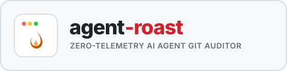

<div align="center">

<picture>
  <source media="(prefers-color-scheme: dark)" srcset="docs/assets/logo-dark.svg">
  
</picture>

<h2>Your AI agent made the tests pass.<br>Did it fix the code, or the tests?</h2>

<p>
  <a href="https://github.com/Nari-Ab/agent-roast/actions/workflows/test.yml"></a>
  <a href="https://www.npmjs.com/package/agent-roast"></a>
  <a href="https://www.npmjs.com/package/agent-roast"></a>
  <a href="LICENSE"></a>
  
</p>

</div>

**agent-roast** catches the changes that turn a red build green by weakening the *checks* instead of fixing the *code*: a
loosened assertion, a skipped or deleted test, a lowered coverage threshold, a CI step allowed to fail. A linter cannot see
these, because every new line looks fine on its own. agent-roast compares the **before and after** of each change, as an
agent hook, a Git hook and a pull request check. It is deterministic and offline: no model, no tokens, no network.

<p align="center">
  
  <br><sub>Real output of <code>npx agent-roast demo</code>, shortened. The scenario is scripted; the review is not.</sub>
</p>

## Try it

```bash
npx agent-roast demo     # ten seconds: a scripted example in a temporary repository, nothing of yours is read
npx agent-roast          # review what you have not committed yet (on a clean tree: replay your last commits)
```

## Stop your coding agent from doing it

```bash
npx agent-roast hook install          # Claude Code, Codex and Cursor
```

For Claude Code there is also a plugin: `/plugin install agent-roast --marketplace Nari-Ab/agent-roast`. Any agent that speaks
MCP can also call agent-roast as a read-only tool, `agent-roast mcp` ([setup](docs/integrations.md#mcp-server)).

When the agent is about to finish, agent-roast reviews everything it changed. If a check got weaker, the agent is **sent back
once**, with the file, the line and the before and after, and told to fix the code instead. If it tries again, you get a
warning rather than an endless loop. Anything agent-roast cannot check lets the agent finish: it never breaks a session. An
intended change is accepted by committing it. Not sure yet? `npx agent-roast hook install --advisory` only warns you and never
sends the agent back. Setup for each agent, what it does not do, and how to pause it: [docs/integrations.md](docs/integrations.md).

> The agent hooks follow each agent's documented hook protocol and are tested with simulated hook input, not yet in long live
> sessions with every agent. Reports of what you see are welcome.

## Check every pull request

```yaml
# .github/workflows/agent-roast.yml
name: Agent Roast
on: pull_request
permissions: { contents: read, pull-requests: write }
jobs:
  audit:
    runs-on: ubuntu-latest
    steps:
      - uses: actions/checkout@v4
        with: { fetch-depth: 0 }
      - uses: Nari-Ab/agent-roast@v1
        with: { comment: true }      # one comment, updated on every push; add `advisory: true` to try it without failing PRs
```

Also: `npx agent-roast review --base origin/main` in any CI, `npx agent-roast init --hook` or the
[pre-commit framework](docs/integrations.md#the-pre-commit-framework) for the next commit, and SARIF output for code scanning.
Policy is read from the **base** branch, so a pull request cannot switch off the rules that review it. Before you decide,
`npx agent-roast replay` shows what it would have said about your last 50 commits.

## What it catches

| Rule | Fires when | By default |
| --- | --- | :-: |
| `assertion-weakened` | an exact check is replaced by a weaker one: `toBe(42)` → `toBeDefined()`, `toBe(2)` → `toBeLessThanOrEqual(2)`, `toEqual(x)` → `toMatchObject(x)`, `assert x == 1` → `assert x` | blocks |
| `guard-weakened` | a coverage threshold is lowered, `strict` is switched off, a lint rule is downgraded, a CI step may fail, a workflow stops running tests, a `conftest.py` hook sets a report to `passed` | blocks |
| `test-skip` | a test that was already there is switched off or expected to fail: `it.skip`, `@pytest.mark.skip`, `@pytest.mark.xfail`, `it.fails`, `test.fixme`, `t.Skip`, `#[ignore]`, `@Disabled`, `[Ignore]`, `xit`, ... (a new test that is skipped is not reported) | blocks |
| `test-focus`, `trivial-assert` | `.only` / `fit`; `expect(true).toBe(true)` and its relatives in ten languages; a test that asserts on a function it mocked itself | blocks |
| `assertion-removed`, `test-removed`, `expectation-rewritten` | a test loses assertions, disappears, or its expected value is edited next to production code | warns |
| `swallowed-error`, `type-escape`, `stub-abandonment` | `catch {}` / `except: pass`, `as any` / `# type: ignore` / `# pragma: no cover` / `istanbul ignore`, `throw new Error("Not implemented")` | warns |

Renames, moved tests, parametrization, moved assertions and reformatting are recognized and not reported, and neither is a skip
that depends on the environment (`if testing.Short() { t.Skip() }`, `test.skip(isMobile, ...)`). JavaScript/TypeScript, Python
and Go get the full before/after comparison; skips and placeholder assertions also cover Rust, Java, Kotlin, C#, Ruby, PHP and
Swift; CI and config files are checked whatever the language. Each rule with examples and limits: [docs/rules.md](docs/rules.md).

## Configure

Rules, severities and paths live in `.agentroastrc.json` at the repository root (`npx agent-roast init` writes a starting file):

```json
{
  "failOn": ["assertion-weakened", "guard-weakened", "test-skip", "test-focus", "trivial-assert"],
  "rules": { "type-escape": "off" },
  "ignorePaths": ["**/generated/**"]
}
```

A change cannot edit this file to relax its own review, because it is read from `HEAD` or the base branch. To accept one
intentional finding, add an expiring exception instead of turning a rule off, and adopt an existing project without blocking on
old debt with a baseline: [docs/reference.md](docs/reference.md#configuration).

## Does it work?

Measured, with the denominators and the caveats in [docs/benchmarks.md](docs/benchmarks.md). **Weakened checks are rare, mostly
deliberate, and not specific to AI. agent-roast is a tripwire that asks about them. On repositories it had not seen, about half of its
blocks were questions with a harmless answer.**

- **131 of 131** hand-labeled cheating edits are caught and **110 of 110** harmless look-alikes (reformats, moves, raised
  thresholds, environment-gated skips) stay silent. The cases were written with the detector, so they guard against regressions;
  they do not prove accuracy. One gap is documented and still open.
- **12,645 commits** that touch tests or CI/config in 166 public repositories: blocking rules fired on 0.3% of AI-signed commits
  (Claude, Copilot, Cursor, Codex, Devin, aider) and on 0.3% of the others. Inside the same repositories the odds for an
  AI-signed commit were 0.81 times those of another commit (95% CI 0.40–1.67). There is no sign that AI-signed commits weaken
  checks more often.
- **On repositories it was not written from, about half of the blocked commits were false alarms.** Four samples of 39 or 40 public
  repositories (158 in all, 44,878 commits) were replayed and every blocked commit was read. 0.17.0 blocked 74 of 11,604 commits in the
  first sample and 65 of 10,726 in the fourth, and 69% of both were false alarms, mostly a skip on a test that the same commit adds.
  This version, frozen before the fourth sample was drawn, blocked 41 of its 10,726 commits: 20 changed a check a reviewer should see
  (an assertion that got weaker, a gate that was relaxed, a test switched off or left focused) and 21 were false alarms, nine of them in
  one repository. Most of the rest, in the earlier measurements too, were deliberate and explained. One reader (an AI assistant) sorted
  them, so treat the figures as a first estimate ([section 9](docs/benchmarks.md#9-repositories-nobody-had-tuned-on)).
- **9,732 commits compared in full** from 164 public repositories that use coding agents (5,454 of them AI-signed) were reviewed again for the
  last two releases, and every new finding was read. 0.15.0's rules reported 30 new findings there and 7 were false alarms (fixed in 0.16.0);
  0.17.0's rule for an exact check turned into a bound reported 18 in 14 commits, all of them loosened checks, after two false alarms were
  fixed. One reader, and a convenience sample ([section 7](docs/benchmarks.md#7-ai-signed-commits-and-a-test-that-checks-its-own-mock),
  [section 8](docs/benchmarks.md#8-an-exact-check-turned-into-a-bound)).
- `replay` ran on 179 public repositories that use coding agents: no commit would have been blocked in 149 of them.
- The rules for **eight more languages** (Go, Rust, Java, Kotlin, C#, Ruby, PHP, Swift) ran on the newest 300 commits of 39
  repositories and every finding was read: 26 of 99 were skips that depend on the environment, now fixed; of the 73 left, 56 are
  tests that really are switched off and 17 are deliberate test data. One reader, and the fixes were made on the same
  repositories, so expect a few new false alarms elsewhere.

## How it compares

TDD Guard and Probity enforce a *process* (tests first) through agent hooks; aislop scans for broad "AI slop" across 11
languages; hallucinot, fakegreen and SlopGate look at diffs for the same shortcuts; linters and coverage gates see the current
code but not that a check got weaker. agent-roast narrows to one question, reads the full before and after, and says how it was
measured. Most of these tools are complementary. [docs/comparison.md](docs/comparison.md) has the details.

## Safe to run on code you do not trust

- **Offline.** No network request, no model call, no telemetry; a test inspects the bundle for network modules.
- **Reads, never runs.** It reads Git objects (or regular files inside the repository for `--worktree`) and never executes
  project code, hooks, diff programs or package scripts. Reports escape control characters.
- **Policy from the trusted side.** The rules come from `HEAD` or the base branch, not from the change under review.
- **Honest about gaps.** An incomplete scan exits 2, never "clean". [SECURITY.md](SECURITY.md) says how to report a problem.

It is a review aid. It cannot prove who wrote a change or that code is correct, and it reads text, not program meaning.

## Documentation

[Rules](docs/rules.md) · [Integrations](docs/integrations.md) · [Reference](docs/reference.md) (commands, exit codes,
configuration, exceptions, baselines, limits) · [Comparison](docs/comparison.md) · [Measurements](docs/benchmarks.md) ·
[Try it on your repository](docs/pilot.md) · [Contributing](CONTRIBUTING.md) · [Changelog](CHANGELOG.md)

Found a finding that was wrong, or a shortcut it missed? That is the most useful report there is:
[open an issue](https://github.com/Nari-Ab/agent-roast/issues/new/choose).

## License

[MIT](LICENSE). Created by Nariman Abdukarimov.
