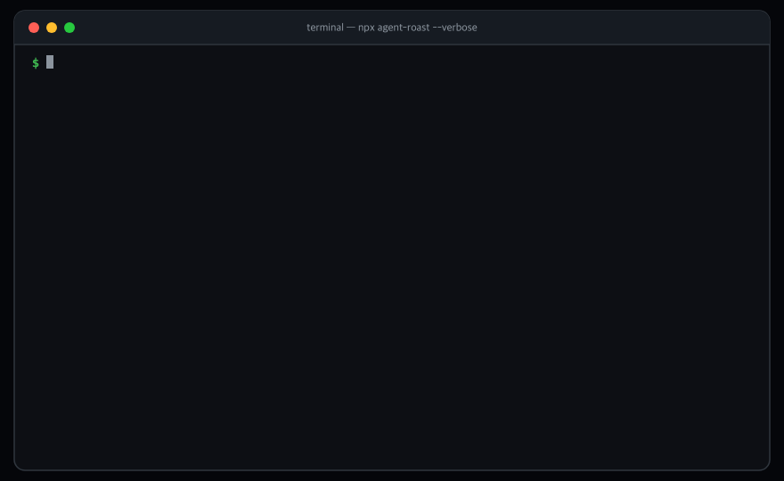
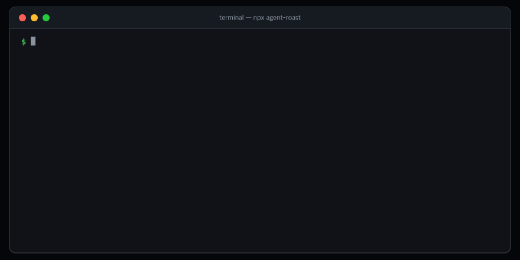

<div align="center">

<picture>
  <source media="(prefers-color-scheme: dark)" srcset="docs/assets/logo-dark.svg">
  
</picture>

<h2>Catch weakened tests and quality gates before they ship</h2>

<p>
  <a href="https://github.com/Nari-Ab/agent-roast/actions/workflows/test.yml"></a>
  <a href="https://www.npmjs.com/package/agent-roast"></a>
  <a href="https://www.npmjs.com/package/agent-roast"></a>
  <a href="https://nari-ab.github.io/agent-roast/"></a>
  <a href="LICENSE"></a>
</p>

</div>

**Did this change fix the code, or only make the checks pass?**

A red build can be turned green by changing the *checks* instead of the *code*: loosening or
deleting the failing assertion, removing the test, lowering the coverage threshold, switching
off `strict`, or letting a CI step fail. Nothing in the new file looks wrong, so a linter
cannot see it. `agent-roast review` compares the **before and after** of a change and reports
exactly these moves. It is offline, runs no project code, and needs only Git. It was built to
review AI-assisted changes, but it cannot tell who wrote a change, and the measurements below
show these moves are not specific to AI.

```bash
npx agent-roast review --base origin/main        # a pull request
npx agent-roast --staged                         # what you are about to commit
```

| Rule | Fires when | By default |
| --- | --- | --- |
| `assertion-weakened` | an exact check is replaced by a weaker one: `toBe(42)` → `toBeDefined()`, `assert x == 1` → `assert x`, `isinstance(...)` → `is not None` | blocks |
| `guard-weakened` | coverage threshold lowered, `strict`/`noImplicitAny` off, lint rule downgraded, an existing CI step allowed to fail, a workflow that stops running tests or stops running on push and pull requests, a test script that cannot fail | blocks |
| `assertion-removed` | a test keeps its name but loses assertions | warns |
| `test-removed` | a test (or test file) disappears and no identical body appears elsewhere | warns |
| `expectation-rewritten` | an expected value changed, test inputs did not, and production code changed in the same PR | warns |
| `test-skip`, `test-focus`, `trivial-assert`, `swallowed-error`, `type-escape`, `stub-abandonment` | the classic shortcuts, compared before/after so old debt does not block | skip, focus and trivial-assert block |

Renames, moved tests, parametrization, assertions moved into a new helper, and formatter
rewraps (prettier, black) are recognized and not reported. Intentional cases can be accepted
one by one with an expiring, reviewed exception (see below). Policy is read from the base
branch, so a PR cannot switch the rules off for itself.

### How well does it work?

Measured, not promised; method, corpus and raw numbers are in
[docs/benchmarks.md](docs/benchmarks.md). **Short version: weakened checks are rare, usually
deliberate, and not specific to AI. The tool finds them; a person decides.**

- **Labeled changes** (`benchmarks/cases.mjs`): 40 cheating edits across JS/TS, Python, Go and
  CI/config files are caught and 33 harmless look-alikes (reformat, rename, move, parametrize,
  helper extraction, raised thresholds, CI restructuring) stay silent. The cases were written
  together with the detector, so they guard against regressions; they do not prove accuracy.
  Three known gaps are listed in the file and still open: mocking the module under test,
  hardcoding the tested value, and vacuous matchers such as `expect.anything()`.
- **Five mature open-source projects** (commander.js, execa, click, requests, zod; 606 commits
  that touch tests or CI/config): the blocking rules fired on 3 commits (0.5%), all of them
  deliberate. `assertion-removed` fired on 5 (0.8%), including one real defect:
  a refactor in `requests` dropped the `assert` keyword and left a comparison with no effect.
- **AI-signed commits in 166 public repositories** (signatures from Claude, Copilot, Cursor,
  Codex, Devin and aider; 12,645 commits that touch tests or CI/config):

  | | AI-signed | Other commits |
  | --- | ---: | ---: |
  | Repositories | 160 | 141 |
  | Commits reviewed | 6,895 | 5,750 |
  | Blocking rules | 0.3% (20) | 0.3% (16) |
  | `assertion-removed` (warns) | 2.4% | 2.2% |
  | `test-removed` (warns) | 15.4% | 12.7% |
  | `expectation-rewritten` (warns) | 5.7% | 5.5% |

  Compared inside the same repository (135 repositories with both kinds), the odds of a
  blocking finding in an AI-signed commit are 0.81 times those of another commit (95% CI
  0.40-1.67): no sign that AI-signed commits weaken checks more often. Claude accounts for
  5,380 of the AI-signed commits; the other agents are too few to compare.
- **Hand-read precision.** Findings were read without knowing who wrote the commit (one
  reader, an AI assistant; not independently verified). On repositories the detector had never
  seen, the 11 blocking findings were 2 unexplained relaxations (TypeScript strictness switched
  off in commits titled "Changes"), 7 deliberate and explained changes, and 2 false alarms. Of
  24 `assertion-removed` warnings, 1 was an unexplained weakening, 12 deliberate, 6 unclear and
  5 false alarms. So most findings are decisions a reviewer should see rather than mistakes,
  and roughly one in five is a false alarm. Earlier rounds (76 findings) were used to fix the
  detector and are not counted here.

Caveats. A signature shows a tool was involved, not how much, and unsigned AI help in the
"other" group would hide a difference. The repositories came from searching for those
signatures, so many are small personal projects. This measures what was committed, not what an
agent tries mid-session: a weakened check fixed before the commit is invisible. Labels are one
reader's opinion. Three small fixes (assertion helpers, throwing test-library queries,
scheduled-only workflows) were added after the labeling and have regression cases, but were not
re-labeled.

It is a **review aid**: it cannot prove who wrote a change or that code is correct, and it
reads text, not program semantics. A green result is not a quality certificate.

**Want to see what it says about your repository?** [docs/pilot.md](docs/pilot.md) has a
five-minute look back, an advisory workflow that never fails a pull request, and a feedback form.
Counts are enough; no code is needed.

### Quick start

```bash
# Everything that is true of the code you have now
npx agent-roast check
npx agent-roast explain swallowed-error

# Adopt in an existing project without blocking on historical debt
npx agent-roast check --write-baseline .agentroast-baseline.json
npx agent-roast check --baseline .agentroast-baseline.json

# Optional: score a repository's history
npx agent-roast --all --verbose
```

A finding includes its file and line, the evidence, and a concrete next step.
`--format json|markdown|sarif|github` are available; terminal output shows the 20 most
important findings (rules that block first, then the before/after rules, then the noisier
line patterns).

### Context review for pull requests

```bash
# Compare committed source at the common ancestor and candidate head
agent-roast review --base origin/main --head HEAD
agent-roast review --base origin/main --format markdown

# Export a report for tools that consume SARIF 2.1.0
agent-roast review --base origin/main --format sarif > agentroast.sarif
agent-roast check --format sarif > current-code.sarif
```

`review` compares **full contents of changed source files**, so deleting the only
handler inside a `catch` is detectable even when no suspicious line was added.
It reports new findings, existing findings, and patterns no longer detected. Only
new blocking findings fail the check; no manually generated baseline is required.
Deleting a file is reported as disappearance of a pattern, not proof of a correct fix.

Source is read directly from immutable Git blobs at the merge-base and head. The
worktree and index are left untouched, and project code, hooks, diff programs and
package scripts are never executed. Use `check` for uncommitted working files, and
`--staged` for the index. Source comparison and policy are pinned to the reported SHAs.

Policy comes from the explicitly supplied **base ref tip**; source comparison starts
at the merge-base. Candidate changes to `.agentroastrc.json`, `.agentroastrc` or
`agent-roast.config.json` are reported and ignored for this review. Adopt policy
changes through separate human review. An explicit `--fail-on` overrides blocking
severity but does not enable rules disabled by base policy.

```bash
# Advisory pilot: inspect findings before deciding what should block the team
agent-roast review --base origin/main --fail-on ''
# Gate the shortcuts the team agrees matter
agent-roast review --base origin/main --fail-on test-skip,trivial-assert,swallowed-error
```

Matching uses rule, source snippet and occurrence count within a file pair. Line
shifts and Git-recognized pure renames do not turn old debt into new debt. A second
identical occurrence is new. This is not semantic tracking: rewritten snippets or
language changes can require fresh review, and Git's rename recognition is heuristic.

Limits: 1,000 changed files, 2 MiB per source blob, 50 MiB across inspected versions,
30 seconds per Git command. Symlinked/binary/oversized source and missing comparison
objects yield exit 2, never a clean pass. Partial clones and ambiguous multiple
merge-bases are unsupported; fetch complete local history (`fetch-depth: 0`). The
report counts excluded and unsupported changes explicitly. Only changed supported
files are compared; this is not a whole-repository safety certification.

SARIF includes rule metadata, relative locations, stable occurrence fingerprints
and whether the scan completed. Source snippets are omitted from SARIF. JSON and
Markdown reports contain evidence snippets and should be handled as source code.
SARIF output is generated offline; uploading it is a separate, optional operation.
GitHub supports SARIF ingestion, but this release has not been tested with a live
code-scanning upload. Some findings on unchanged lines (including deletion-only
regressions) may appear in the report/summary rather than as an inline PR annotation.
Use a separate SARIF category for introduced-findings review; it does not represent
a full scan of all outstanding alerts.

Install 0.10.1: `npx agent-roast@0.10.1 review --base origin/main`. For local development,
run `npm run build` and use `node dist/cli.js`.

### Precise exceptions (since 0.8.0)

Use `npx agent-roast@0.10.1 check --format json`, or build this checkout with
`npm run build` and run `node dist/cli.js`.

Some skipped integrations or abstract stubs are intentional. In 0.8.0 you can accept
one exact finding without switching off the rule or ignoring its whole file:

1. Run `node dist/cli.js check --format json` and inspect the evidence. Findings
   include a stable `fingerprint` (rule, relative filename and trimmed source snippet).
2. Add a reviewed `exceptions` entry to the root `.agentroastrc.json`, with the
   fingerprint, the **total** allowed occurrence count, a reason and an expiry date.
3. Run the check again. Accepted findings remain visible with their reason/date;
   additional duplicate occurrences still block. Expired exceptions stop applying.
   Use a full `check` to revisit old findings; `review` continues gating newly
   introduced debt, so expiration does not turn unchanged old debt into a new finding.

```json
{
  "exceptions": [
    {
      "fingerprint": "f4d1212234f00381d0eaed359e3229fe4ff47388affc9eac0d0d89daffea13d6",
      "count": 1,
      "reason": "Integration sandbox unavailable; restore under ENG-42",
      "expires": "2026-11-15"
    }
  ]
}
```

The example fingerprint is for `it.skip('temporary');` in `auth.test.ts`; copy the
fingerprint from **your** report. Expiry includes the specified day in UTC. Changing
the rule, path or source snippet requires review again. Counts from an exception and
baseline do not add together to accept extra identical occurrences.

For committed/staged context reviews the allowance must already exist in the trusted
base/HEAD policy. A candidate PR or unstaged config cannot approve itself; first
commits use built-in defaults. `check` intentionally reads the current root policy.
Use `--ignore-exceptions` with `check`, `review` or `--staged` to inspect accepted
findings again. This flag does not disable a separately supplied baseline.
Exceptions apply to these context/current-source workflows; historical and legacy
added-line audits do not apply them. A full scan can use baseline adoption for old
debt, while exceptions record temporary reviewed decisions about particular findings.

JSON/Markdown/terminal reports separate accepted exceptions from actionable findings.
SARIF retains accepted records with `suppressions` and their justification/expiry;
JSON and SARIF include stable occurrence identities. SARIF omits code snippets but
includes exception reasons, so review those before sharing reports.

An offline editor schema is included as `schema.json` in the npm package. When using
a local dev dependency, set `$schema` to `./node_modules/agent-roast/schema.json`.
Ignore policies are bounded to 1,000 patterns of at most 1,024 characters each.
Unknown settings, invalid severities and malformed exceptions fail with exit 2.
Root policy must be a regular UTF-8 file no larger than 64 KiB. Simple ignore globs
support `*`, `?`, `**` and directory prefixes; they are not full `.gitignore` syntax.

### Baseline adoption

A baseline explicitly accepts the findings present at adoption time. It does not fix
or hide new code. Fingerprints use the rule, repository-relative filename and source
snippet; line numbers are excluded so adding clean code above a finding does not
break it. Occurrence counts ensure a second identical shortcut is still new. Moving
a finding to another file or changing its snippet requires a fresh review. Baselines
contain hashes and counts, not source code. The report shows both accepted and new
findings and counts accepted findings no longer present.

Baseline use is explicit (`--baseline`), and writes refuse to overwrite existing
files. To refresh accepted debt, inspect the full scan and write a **new** baseline
file for review. Treat baseline changes as policy changes in code review. Do not
silently regenerate one in CI. Input/output baseline paths are relative to the
directory passed to `check` (or the current directory if omitted).

`check` scans the repository containing the supplied path, applies its root config,
respects Git ignores for untracked files, and excludes generated dependencies/build
outputs. It checks working files, while `--staged` checks the index. Git submodules
are not recursively scanned. A supported file that is binary, too large, unreadable
or a symlink makes the scan incomplete (exit 2); incomplete scans cannot create a
baseline. Limits are 2 MiB per source file and 50 MiB per scan. Intentional generated
or unsupported input should be excluded in `ignorePaths`, not silently counted clean.

History auditing remains available when you want an overview of prior shortcuts:

What a report looks like (a real repository audit, trimmed):

```text
agent-roast — git discipline audit (304 AI commits in Soup)

SCORE: 55 / 100 · The Panic Looper
  Prone to rapid-fire fix and revert thrashing cycles when wrestling stubborn bugs.

INFRACTIONS DETECTED (42)

  ● panic-loop (15) — consecutive quick fixes < 15m apart
      latest: 3df29a1 -> a910f21 (3m apart)

  ● type-escape (19) — compiler type bypasses in added lines
      e.g. src/client.ts:42 — response.body as any

  ● test-skip (6) — disabled or skipped test suites
      e.g. tests/test_outbound.py:18 — pytest.skip(...)

  ● trivial-assert (2) — tautological assertions faking test coverage
      e.g. tests/auth.test.ts:31 — expect(true).toBe(true)

  ● stub-abandonment (1) — incomplete stubs left behind
      e.g. src/payment.ts:18 — throw new Error("Not implemented")

  ● swallowed-error (2) — empty catch blocks or except: pass
```





---

### Configuration (`.agentroastrc.json`)

Configure custom ignore paths, rule severities, and CI thresholds with a `.agentroastrc.json` file in your repository root:

```json
{
  "ignorePaths": [
    "**/*.min.js",
    "**/vendor/**",
    "**/dist/**",
    "**/fixtures/**"
  ],
  "rules": {
    "test-focus": "error",
    "swallowed-error": "warn",
    "trivial-assert": "warn",
    "stub-abandonment": "warn"
  },
  "scoreThreshold": 70
}
```

---

### Check code before committing

```bash
npm install --save-dev agent-roast
npx agent-roast --staged
npx agent-roast init --hook
```

Since 0.7.0, `--staged` (also `review --staged`) compares the **full source**
of changed files in HEAD and the Git index. It detects deletion-only empty handlers
and retains comment context. Existing findings do not block; additional occurrences
do. Unstaged edits, untracked files and `git add -N` intent-to-add entries are excluded.
The older 0.6.0 `--staged` command checks only added index lines. Since
0.8.0, it also reads Git's temporary candidate index during real `commit -a` / `--only`
hooks. An alternate `GIT_INDEX_FILE` outside this checkout's Git metadata is refused
with exit 2; it cannot silently redirect the check to a different commit.

Policy comes from HEAD. Staged/unstaged config edits cannot weaken this check and
are reported; adopt policy changes in a separately reviewed commit. With no HEAD,
the first commit uses built-in defaults; use `--fail-on` for an explicit override.
For example: `node dist/cli.js review --staged --fail-on test-skip,test-focus,swallowed-error`.
Source is pinned by Git blob IDs. If HEAD or the staged inventory changes before the
scan finishes, it exits 2 and asks for a rerun. The report's `source` is `index`;
`headSha` is an `INDEX:` snapshot digest, not a commit SHA, and an unborn base is `EMPTY`.
The JSON schema version for context reviews is now `1.1.0`.

The generated hook uses the locally installed CLI (`--no-install`) and blocks on configured error rules instead of scoring
old commits. It preserves an existing pre-commit hook.

`init` resolves the repository root even when run from a package/subdirectory, so
its policy is used by `check` and its workflow can be discovered by GitHub. Outside
a Git repository, initialization uses the supplied directory. Its output shows the
actual destination and existing policy/hooks are preserved.

### Configure what blocks a change

Create `.agentroastrc.json` (or run `npx agent-roast init`):

```json
{
  "rules": {
    "test-skip": "error",
    "test-focus": "error",
    "trivial-assert": "error",
    "swallowed-error": "warn",
    "type-escape": "off"
  },
  "ignorePaths": ["**/generated/**", "**/vendor/**"],
  "panicLoopWindowMinutes": 10,
  "scoreThreshold": 70
}
```

`off` removes findings and score penalties; `warn` reports without blocking a diff;
`error` blocks PR/staged checks, including `test-focus` by default in 0.7.0. An explicit `failOn` array overrides which enabled
rules block (`[]` makes the audit advisory). CLI `--fail-on` takes precedence over
that array. History and badge audits honor disabled rules and the panic-loop window.
History exit status is controlled by `scoreThreshold` or `--fail-under`.
Invalid JSON, unknown rule names and invalid settings stop the audit with exit code 2.
Configurations generated by older versions may contain unsupported rules such as
`hallucinated-package`, `empty-catch` or `mock-leak`; remove these entries and use
`swallowed-error` for empty catches.

Exit codes: `0` passed, `1` blocking findings/score threshold, `2` invalid configuration,
Git refs or an incomplete scan. Since 0.8.0, legacy/history CLI audits also return 2
when lines were skipped or supported source was marked binary by Git attributes,
instead of treating missing coverage as a clean result. `--format json` also works for history audits. A history
sample below 200 added lines has no score, but its findings are still shown.

### GitHub Actions Integration

Add `agent-roast` as a gate in your pull request workflow (`.github/workflows/agent-roast.yml`):

```yaml
name: Agent Roast
on:
  pull_request:
    branches: [main]

permissions:
  contents: read

jobs:
  audit:
    runs-on: ubuntu-latest
    steps:
      - uses: actions/checkout@v4
        with:
          fetch-depth: 0 # Required for complete merge-base history

      - name: Run agent-roast audit
        uses: Nari-Ab/agent-roast@v1
        with:
          format: github
```

To pilot the Action without blocking on findings, set `advisory: true`. It passes
an explicit empty fail-on list; invalid configuration, Git errors and incomplete
scans still fail. The `v1` Action installs 0.10.1. The CLI equivalent is `--fail-on ''`.

> **Security Note:** `agent-roast` runs in an isolated runner directory (`$RUNNER_TEMP`) with `--ignore-scripts` to neutralize malicious `.npmrc` files in untrusted pull requests. `pull_request_target` is not supported.

---

### What it checks

`check` scans current source. `review` scans both full versions of changed source;
the 0.7.0 `--staged` command does the same for HEAD and index. Legacy
`--base` and history audits inspect added lines. Comment/literal masking reduces
noise; these are heuristic checks and can have false positives and missed findings.

- **Focused tests (`test-focus`):** Exclusive `test.only`, `it.only`, `describe.only`, `suite.only`, Playwright `test.describe.only` and common modifier chains in JS/TS-family sources. `fit` / `fdescribe` aliases are recognized in conventional test paths. Supports contiguous multiline chains and ignores literal/comment examples. Default blocking rule; an existing explicit `failOn` list must include it to block. This does not resolve imports or custom aliases; configure your runner's native forbid-only option too when available ([Playwright](https://playwright.dev/docs/api/class-testconfig#test-config-forbid-only), [Jest API](https://jestjs.io/docs/api#testonlyname-fn-timeout)).
- **Skipped tests (`test-skip`):** `it.skip`, `describe.skip`, `xit`, `pytest.skip`, `test.todo` added to silence failing tests. (Default blocking gate).
- **Trivial assertions (`trivial-assert`):** Tautological or dummy assertions added to fabricate test green checks (`expect(true).toBe(true)`, `expect(1).toBe(1)`, `assert True`, `self.assertTrue(True)`).
- **Stub abandonment (`stub-abandonment`):** Dummy stubs left unimplemented in committed code (`throw new Error("Not implemented")`, `raise NotImplementedError`, Rust `todo!()` / `unimplemented!()`).
- **Type escapes (`type-escape`):** `as any`, `as unknown as`, `as never`, `// @ts-ignore`, `// @ts-nocheck`, `// @ts-expect-error`, `# type: ignore`, `# noqa`, `eslint-disable`.
- **Swallowed errors (`swallowed-error`):** Empty `catch {}` or `except: pass` blocks hiding runtime failures.
- **Panic fix loops (`panic-loop`):** Heuristic chain analysis of rapid-fire fix/revert commits by the same author within 15 minutes touching overlapping files. *(Observational metric for repository audits; not a PR blocker)*.

---

### Scoring Methodology

- **Repository Audit Score:** Uses size-invariant defect density:
  $$\text{Score} = 100 \cdot \exp\left(-\left(\frac{\text{codeDensity}}{R_0} + \frac{\text{panicDensity}}{R_1}\right)\right)$$
  where defect points are normalized by effective sample volume ($k\text{Loc} + 0.5$). Repositories with fewer than 200 lines added return `null` (insufficient data) rather than an arbitrary 100.
- **Pull Request Mode:** Avoids unstable micro-sample scores. Reports verified infractions, pass/fail status, and reference defect density per 100 LOC. Author identities are hidden by default to prevent team blame games.

---

### Requirements & Privacy

- **Requirements:** Git 2.30+ (for `--end-of-options` argument isolation), Node.js 18+.
- **100% Local:** Instant streaming parser runs directly on your machine.
- **Zero Telemetry:** No cloud dependencies, no LLM API calls, no network traffic. Verified by static bundle inspection.
- **Git isolation:** Forces stable diff paths, disables fsmonitor/external diff execution, and reads review content by object identity.

---

### Scope and limitations

Use this as a focused review aid for skipped tests, compiler suppressions and obvious
stubs, alongside a compiler, test runner and language-aware linter. Findings identify
patterns, not proof of AI authorship or developer intent. Deliberate skips and abstract
methods can be legitimate. Since 0.8.0, the analyzer improves language-specific checks, multiline skips/assertions,
Rust raw strings/lifetimes and Java/Kotlin text blocks. Contiguous comments, Python
docstrings and multiline empty handlers are recognized. Template interpolation, complex language syntax and context outside
the added diff in legacy audit modes are not fully parsed. Custom test API aliases,
computed property calls and type/import resolution are not handled. Panic loops are an observational history heuristic.
Test registration options such as Node's `test('name', { skip: true }, fn)` and
`{ only: true }` are currently not inspected; use explicit `.skip`/`.only` APIs and
the runner's CI safeguards. Regexp masking is contextual, not a full JavaScript
parser. Formatting across contiguous lines is supported for casts, empty catches
and placeholder errors, but legacy added-line audits cannot recover missing hunks.
The discipline score summarizes added history; it does not certify current code quality.
`check` reports actionable findings without assigning a personality or quality score.
History attribution is based on explicit text/identity heuristics; it does not prove
AI authorship. Since 0.8.0, the analyzer avoids classifying ordinary people by name fragments
or treating every automation bot as an AI author. Use `--all` for all commits.

The website demos are synthetic illustrations, labeled as such. Older GIF/video
assets are legacy demonstrations, not performance measurements or adoption evidence.
See [related tools and design choices](docs/product/related-tools.md) for approaches
reviewed in Semgrep, Ruff, Gitleaks, reviewdog and eslint-plugin-jest. No third-party
implementation was copied.

### Development

Develop/build/test with Node.js 20.19+ (or 22.12+). The distributed CLI still supports
Node.js 18+. Patched Vitest 4 and build tooling are development dependencies only;
CI runs the current test runner on Node 22 while CLI subprocesses and actual Git hooks
are exercised on Node 18/20/22 using `AGENT_ROAST_TEST_NODE`.

```bash
npm ci
npm run typecheck
npm test

# Optional end-to-end CLI checks in disposable Git repositories
node scripts/verify-user-workflows.mjs dist/cli.js
```

`npm test` builds the distribution first so CLI integration and bundle checks run
against current code. Regression tests use disposable Git repositories. The programmatic
`auditPullRequest({ staged: true })` API retains the legacy added-lines contract;
use `reviewStagedChanges()` for the new context comparison and `ReviewResult`.
The composite Action installs exactly 0.10.1. For local development, use
`node dist/cli.js --staged` after building.

### Author & Support

Created by Nariman Abdukarimov ([abdukarimov.nariman07@gmail.com](mailto:abdukarimov.nariman07@gmail.com)).

### License

[MIT](LICENSE)

